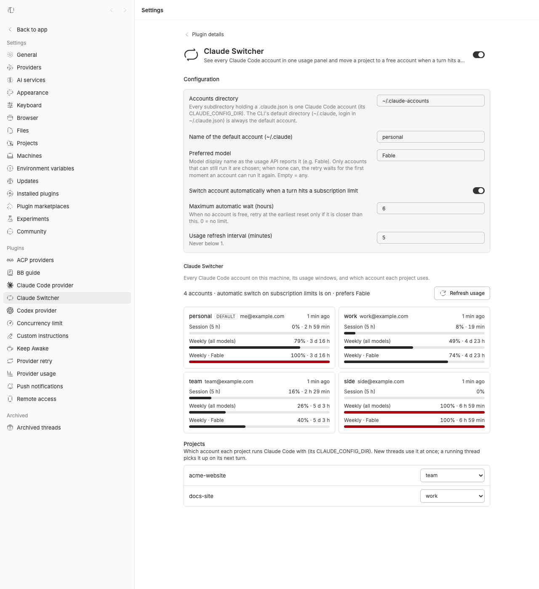
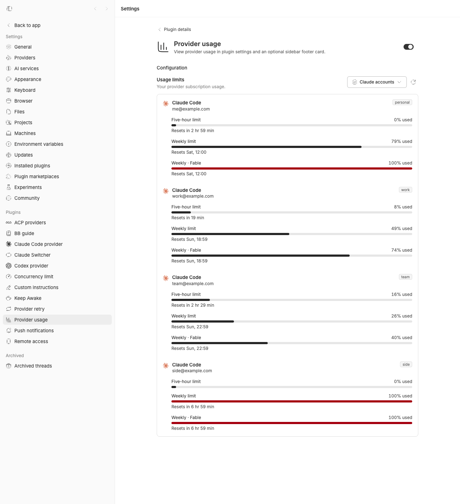
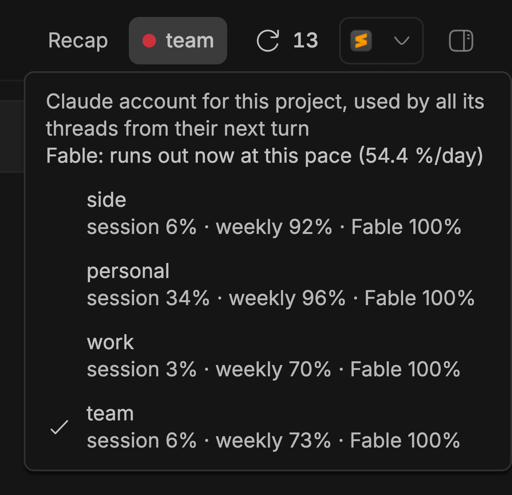
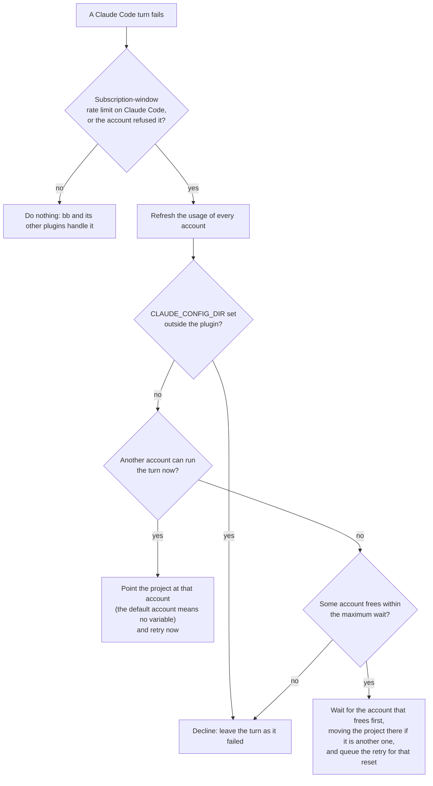

<div align="center">


# Claude Switcher

### Keep working when one Claude Code account hits its limit.

Every Claude Code account on your machine in bb's usage panel.<br>
When a turn hits a subscription limit, the project moves to a free account and the turn runs again.

[](https://github.com/Finolaina/bb-plugin-claude-switcher/actions/workflows/check.yml)
[](LICENSE)
[](https://github.com/get-bb/bb)
[](https://www.npmjs.com/package/@get-bb/plugin-sdk)
[](#install)
[](tsconfig.json)

[Features](#features) · [Install](#install) · [Accounts](#setting-up-extra-accounts) · [How it works](#how-it-works) · [Safety](#safe-by-default) · [CLI](#cli) · [Settings](#settings) · [Design doc](docs/DESIGN.md)

<br>



</div>

<br>

## The problem

You pay for more than one Claude Code subscription so that a limit doesn't
stop you. Then a turn fails with a 5-hour or weekly limit in the middle of
the work.

bb shows the usage of the account it runs on and retries at the reset. It
doesn't know about your other accounts, so you log in to another one by
hand, or wait hours for a reset while the other subscription sits idle.

**Claude Switcher measures every account and moves the project** to the
best free one the moment a turn fails on a subscription limit, then runs
the turn again there. When none is free, it waits for the one that frees
first.

|                                                  | Without Claude Switcher |             With Claude Switcher             |
| ------------------------------------------------ | :---------------------: | :------------------------------------------: |
| See every account's session and weekly windows   |           ❌            |             ✅ in Provider usage             |
| Keep working when one account hits its limit     |           ❌            |             ✅ switch and retry              |
| Start a new project on an account that works     |           ❌            |          ✅ before its first turn           |
| Wait for the account that frees first            |           ❌            |         ✅ within your maximum wait          |
| Stick to a model, like Fable                     |           n/a           |              ✅ preferred model              |
| Choose the account of each project by hand       |           ❌            | ✅ new thread, thread header, picker and CLI |
| Know when a weekly window runs out at your pace  |           ❌            |            ✅ forecast per window            |
| Move before the limit instead of after a failure |           ❌            |         ✅ opt-in, after a turn ends         |
| Add and log in an account without a terminal     |           ❌            |               ✅ from Settings               |
| See why a project moved                          |           ❌            |             ✅ history of moves              |
| Touches a `CLAUDE_CONFIG_DIR` it didn't set      |           n/a           |                   ❌ never                   |
| Shares or pools accounts between people          |           n/a           |                   ❌ never                   |

## Features

<table>
<tr>
<td width="50%" valign="top">

### 📊 Every account in one panel

The 5-hour session, the weekly and the per-model weekly windows of each
account appear in **Provider usage**, next to the usage bb already shows.
Refreshed in the background and on demand.

</td>
<td width="50%" valign="top">

### 🔁 Automatic switch and retry

When a turn fails on a **subscription-window** rate limit, or the account
refuses it, the project moves to the best other account and the failed
turn runs again there.

</td>
</tr>
<tr>
<td valign="top">

### ⏳ Waits instead of giving up

When no account is free, the project moves to the account that frees
first and the retry is queued for that reset, within a maximum wait you
choose. If another account can run it sooner, the turn moves there.
A thread left in error with nothing queued (every retry spent) is
judged again on each refresh, from bb's log. A turn that outlived its
project's move is judged by the account it ran on, not the new one.
When no account has the preferred model left and one can run Opus, the
thread is told to switch to Opus in bb's picker, and where it will go.

</td>
<td valign="top">

### 🎯 A preferred model

Name one (for example `Fable`) and only accounts that can still run it are
chosen. The three Claude Code limits are never treated as interchangeable.
A thread you switch to another model in bb's picker is judged by that
model instead.

</td>
</tr>
<tr>
<td valign="top">

### 🎛️ Manual control

A **Claude Switcher** section in Settings with the account cards, a
per-project account picker and a refresh button, the account in every
thread's header and in the new-thread composer, plus a `bb claude-switcher` CLI.

</td>
<td valign="top">

### 🤝 Plays well with bb

It cooperates with bb's bundled **provider-retry** plugin, uses only
public SDK surfaces, and never touches a `CLAUDE_CONFIG_DIR` it did not set.

</td>
</tr>
<tr>
<td valign="top">

### 🔮 A forecast per window

Under each account's bars, in small text, with when each window resets:
when the window that matters (the preferred model's, else the weekly)
runs out at the pace you have used it since the plugin first measured the
current window, or that it lasts until its reset; each window's tooltip
has its own. Also in the account menu
of a thread's header and of the new-thread composer, and in `list --json`.

</td>
<td valign="top">

### ⏭️ Switch ahead of the limit

Opt-in. Set a percentage and, when a turn ends with the project's account
at or above it, the project moves to an account below it, so the next
turn does not fail first. Needs the automatic choice on. A second
percentage covers threads running in another model, so an Opus thread
moves at 95 % while Fable threads keep theirs.
Whatever the percentages say, every refresh moves a project off an
account out of the preferred model or without a login, to the best
account with a free seat (bb greys out the composer of such a project, so
no turn would get to move it); with no seat free, it stays.

</td>
</tr>
<tr>
<td valign="top">

### ➕ Add accounts from bb

**Add account** in Settings creates the account's directory, shares your
transcripts and configuration with it and runs Claude Code's own login in
a private Chrome window (macOS; the default browser elsewhere). No
terminal.

</td>
<td valign="top">

### 🧾 History of moves

Every move of a project, automatic or by hand, with the time, the two
accounts and the reason, and every thread told to switch to Opus. In
Settings and with `bb claude-switcher history`.

</td>
</tr>
</table>

<div align="center">
<table>
<tr>
<td align="center"><br><sub><b>Every account in Provider usage</b></sub></td>
<td align="center"><br><sub><b>The account each project runs on</b></sub></td>
</tr>
<tr>
<td align="center" colspan="2"><br><sub><b>The account in every thread's header, and the menu to change it</b></sub></td>
</tr>
</table>
</div>

## Install

```sh
bb plugin install git:https://github.com/Finolaina/bb-plugin-claude-switcher@^0.2.2
```

Then open **Settings → Claude Switcher** (or run
`bb plugin config claude-switcher`), point it at your accounts directory
and set up the extra accounts as described [below](#setting-up-extra-accounts).
Once the plugin is listed in bb's catalog you can also install it from
**Plugins → Browse plugins**, or with `bb plugin install claude-switcher`.

<details>
<summary><b>Install from a local clone</b></summary>

```sh
git clone https://github.com/Finolaina/bb-plugin-claude-switcher.git
cd bb-plugin-claude-switcher
npm install          # dependencies the settings section imports
bb plugin install .  # bb builds the plugin at install time
```

</details>

**Requirements**

- **bb 0.45 or later** (plugin SDK 0.6.15 or later) running on the machine
  that holds the Claude Code logins: macOS (keychain) or Linux
  (credentials file). The plugin runs inside bb's server process.
- **Threads that run on that same machine.** `CLAUDE_CONFIG_DIR` is set as
  a project **machine** environment variable holding a path on bb's
  machine. A thread that runs on another host may get that path, which
  does not exist there; if you run threads on other hosts, turn
  `autoSwitch` off (it is global: there is no per-project opt-out).
- **More than one Claude Code login**, each in its own config directory,
  set up as described in [Setting up extra accounts](#setting-up-extra-accounts).

## Setting up extra accounts

The default account is `~/.claude`, the CLI's own directory (its login
lives in `~/.claude.json`). Every other account is a subdirectory of the
_accounts directory_ setting (`~/.claude-accounts` by default) that
contains a `.claude.json`.

**The short way: Settings → Claude Switcher → Add account.** Type a name
and the plugin creates `<accounts directory>/<name>`, links what a thread
needs from `~/.claude` into it (the entries of step 1 below that exist
there, plus `skills`, `agents`, `commands` and `rules`) and runs
`claude auth login` for that directory. On macOS the login page opens in
a private Chrome window, so it does not reuse the Claude session of your
browser (your default browser when Chrome is not installed, when
`loginPrivateWindow` is off, and always on Linux). Approve it there and the account appears
with its usage. While the login runs, the section shows a link to the
login page and a field for the code that page gives you, for when no
window opens. When it ends, the section says if something is off: no
login was left, or the account is the Claude account of another
directory (the browser answered with the session it had). An account listed
without a login gets a **Log in** button that does the same, and a
directory logged in to the Claude account of another one says so on its
card and gets **Log in again**. The plugin
links nothing into a directory that already existed.

The rest of this section is the same setup by hand.

**1. Share what a thread needs.** A switch changes the whole config
directory of the project: Claude Code reads its settings, hooks,
`CLAUDE.md`, plugins and, above all, the session transcripts
(`<dir>/projects/`) from there. A fresh directory has none of them, and a
thread whose transcript lives under another directory cannot be resumed
("No conversation found with session ID"). Symlink what must follow the
thread from `~/.claude` into each account directory before its first use,
at least `projects`, and normally `settings.json`, `hooks`, `CLAUDE.md`,
`plugins` and your `skills`, `agents`, `commands` and `rules`:

```sh
acct=~/.claude-accounts/work
mkdir -p "$acct"
for f in projects settings.json hooks CLAUDE.md plugins skills agents commands rules; do
  [ -e ~/.claude/$f ] || continue
  [ -L "$acct/$f" ] || { [ -e "$acct/$f" ] && mv "$acct/$f" "$acct/$f.orig.$(date +%Y%m%d%H%M%S)"; }
  ln -sfn ~/.claude/$f "$acct/$f"
done
```

Run it when you create the directory or later; it is safe to repeat.
What Claude Code already created there is kept as `<name>.orig.<time>`,
so transcripts of sessions already run on that account stay in
`projects.orig.<time>` (move them into `~/.claude/projects/` if you want
to resume them). A plain `ln -s` is wrong once `projects/` exists: it
links inside it and says nothing.

**2. Log in once**, with the exact path the _accounts directory_ setting
names (no trailing slash: Claude Code keys the login by that string):

```sh
CLAUDE_CONFIG_DIR=~/.claude-accounts/work claude   # then /login
```

The plugin finds the new account on its next refresh.

MCP servers added with `claude mcp add -s user` live in each directory's
`.claude.json` (it also holds the login, so it cannot be shared): add them
again per account, or use a project-level `.mcp.json`. Without shared
transcripts, the retry of the failed turn itself fails with "No
conversation found", no thread can move between accounts in either
direction (a thread whose project is placed on another account right
after its first turn fails the same way at its second), and a thread that
starts on a fresh account runs without your settings, hooks and
`CLAUDE.md`.

## Where to find it

| Where                                                | What                                                                                                                                                                                                                                                                                                                                                                                                                                                                                                                                                                                                                                      |
| ---------------------------------------------------- | ----------------------------------------------------------------------------------------------------------------------------------------------------------------------------------------------------------------------------------------------------------------------------------------------------------------------------------------------------------------------------------------------------------------------------------------------------------------------------------------------------------------------------------------------------------------------------------------------------------------------------------------- |
| **A Claude Code thread's header**                    | The project's account with a dot (green: room, amber: running low, red: out or not logged in, grey: not measured), and a menu with the forecast of its window, to switch now to the best account or pick any other.                                                                                                                                                                                                                                                                                                                                                                                                                       |
| **The new-thread composer**                          | The same control for the project picked there, before the first message, with the best account beside it when it is another one. A pick there before you send, even of the account shown, keeps a new project from moving to the best account after its first turn. With automatic switching on, the rules that move any project still apply: your preferred model when the thread is created, the model a message is sent with, limits and refusals. Send after the pick is saved: a message sent in that moment can start on the old account. On a phone it shows once the composer is open. It hides while another provider is picked. |
| **Settings → Claude Switcher**                       | The ten settings, a card per account with its windows and their forecast, **Add account** and **Log in**, the account each project runs on (with a picker), **Refresh usage**, and the history of moves.                                                                                                                                                                                                                                                                                                                                                                                                                                 |
| **Settings → Provider usage** (and its sidebar card) | Pick **Claude accounts** in the source menu to see every account's session, weekly and per-model windows.                                                                                                                                                                                                                                                                                                                                                                                                                                                                                                                                 |
| **A thread's retry reason**                          | `Switched to account <name>`, `Waiting for <name>` or `Retrying on account <name>`, wherever bb shows why a turn was retried; a wait for the preferred model with no account left that has it may end with `Sin <model> en ninguna cuenta: pasa este hilo a Opus con el selector de modelo; irá a <name>`.                                                                                                                                                                                                                                                                                                                              |
| **A thread's composer**                              | When a failed turn in the preferred model is left with nothing queued (beyond the maximum wait, or no account will free) and an account can run Opus: a banner saying `Sin <model> en ninguna cuenta: pasa este hilo a Opus con el selector de modelo; irá a <name>`. It only shows: the switch is yours.                                                                                                                                                                                                                                                                                                                               |
| **`bb plugin logs claude-switcher`**                 | Every switch, wait and decline, with its reason.                                                                                                                                                                                                                                                                                                                                                                                                                                                                                                                                                                                          |
| **`bb claude-switcher`**                             | The CLI: `list`, `refresh`, `history`, `use`, `release`.                                                                                                                                                                                                                                                                                                                                                                                                                                                                                                                                                                                  |

## How it works

One account is one Claude Code config directory (`CLAUDE_CONFIG_DIR`).
The plugin measures every account in the background. When a turn fails,
it decides between three outcomes:



- **When a thread is created.** A project created after the plugin first
  ran (for an update from 0.2.1, after the first start of 0.2.2), with no
  account of its own yet, goes to the best account before its first turn:
  bb asks the plugin before it sends a thread's first message, and the
  plugin places the project then. While the accounts are measured for it,
  that message waits once, up to 5 s (`Choosing a Claude account for this
  new project`), and goes as soon as the project is placed. A project
  whose account is already measured out moves to another one when its
  thread is created. This races the thread's first turn: if the turn
  starts first on the old account and fails, it is retried once on the
  new account; if it succeeds there, the thread's next turns run on the
  new account, which needs the shared transcripts described in
  [Setting up extra accounts](#setting-up-extra-accounts). A project you
  pinned by hand (the default account included) stays put while its
  account works.
- **Where the default account has no login.** The default account is
  the `~/.claude` of the machine bb's server runs on; where nobody logged
  in there (a server moved to a new machine), a turn on it fails with
  «Not logged in». Before such a turn, a project left on it moves to the
  best account that can run the turn, even one that keeps its weekly for
  the preferred model (`Moved to account <name> before the turn: <old> is
  not logged in`), whatever model the message is sent with (one bb does
  not name as a Claude model is placed for the preferred one). While
  something that could give the project an account is under way or has
  failed (its placement, the write of its account, the first measure of
  the accounts after the plugin loads, the look at the default's own
  login), the message waits, up to three times 5 s per message
  (`Looking for a Claude account with a login for this project`), and
  goes as soon as that ends. A login still not checked by then counts as
  missing (the refusal says `has a login that could not be checked`), and
  so does one whose check failed (its store could not be read, or its
  refresh failed): the project moves as if the default had no login. A
  usage query that fails after the login was read still counts as a login.
  A pick by hand saved while the first placement writes wins over it.
  When no account can, bb
  refuses the message with
  `Claude Switcher: no account assigned to this project and the default
  account (<name>) has no login. Assign one with: bb claude-switcher use
  <project id> <account>`, and nothing runs. A project with an account of
  its own is never refused for this, also when the accounts directory
  cannot be read: its turn runs on the variable it has, and the log says
  `not placed before its turn; it runs on the project's own
  CLAUDE_CONFIG_DIR`. The login is judged where the plugin
  runs: a thread on another machine, whose own `~/.claude` may have a
  login, is moved or refused the same way.
- **Before every turn.** bb tells the plugin the model each message is
  sent with. When the project's account is measured unable to run that
  model and another account can, the project moves there before the turn
  starts, and a turn that fails on a limit is judged against that model
  too. So a thread you switch to Opus runs on an account with Opus left
  even when `preferredModel` is `Fable` and no account has Fable left,
  while a thread sent with Fable waits for Fable as before. A Max
  account that still keeps Fable is no target for an Opus turn at all:
  its weekly window and Fable's reset together (measured 2026-10-13), so
  what Opus spends there is Fable's. A known project on such an account
  moves to a Team seat (whose Opus turn spends only its 5-hour session)
  or to an account out of Fable before the Opus turn, and comes back
  before its next Fable turn: the plugin remembers, in memory, the
  account the project left for that (a reload forgets it, and the project
  stays where it is; a pick by hand, also one that confirms the account,
  and `release` forget it too). When no account spares Fable the Opus
  turn stays where the project is and the log says so (`stays on …: no
  account spares Fable`). The history reads `Moved to account … before
  the turn: … would spend Fable's weekly` on the way out and `Moved back
  to account … before the turn: … was an excursion for Opus` on the way
  back. A failed Opus turn then waits only for an
  account that will spare Fable when the retry is sent, or is left alone
  (`reserved-for-preferred-model`), and a leftover Opus turn is never
  retried on such an account, not even after a pick by hand of it: the
  pick stands for the project's next turns in Fable, while an Opus turn
  that fails there is judged like any other and may move the project
  out. This is
  decided on the measurements already there and never refuses a message
  (at worst it delays it 3 seconds); the plugin never changes a thread's
  model. bb does not ask for a Send now of a queued message nor for an
  edited message sent again: those run where the project is.
- **When a turn ends (opt-in).** With `switchAheadPercent` above 0 and
  `autoSwitch` on, the
  plugin measures the project's account when a turn of one of its threads
  ends. If its session, weekly or preferred-model window is at or above
  that percentage and another account is below it in all three, the
  project moves there. No turn is interrupted and no retry is spent; a
  turn of the same project still running on the old account is covered by
  the minute of grace described below. When every other account is also
  at or above the percentage, the project stays: it only moves to an
  account under the percentage, measured in the last two refresh
  intervals, that is another Claude account. This also moves a project you pinned
  by hand; leave the setting at 0 to move only on a failed turn.
  A thread sent with another model than `preferredModel` uses
  `switchAheadOtherPercent` instead: it is measured on its session, weekly
  and that model's window, and the account it moves to is the best one
  for that model (accounts out of the preferred model first, then Team
  seats, whose Opus turn spends only the session, then the rest). Set one
  percentage and leave the other at 0 to move only threads in that model.
- **The forecast is shown, never acted on.** For each weekly window the
  plugin keeps its first measurement of the window and the latest, and
  reports the average pace between them: "runs out in 2 d 5 h at this
  pace (30 %/day)" or "lasts until the reset". It needs two hours between
  the two,
  and says nothing for a window that grows less than one point a day.
  Moves are decided on measured usage only.
- **Only visible threads.** Hidden threads (another plugin's workers) are
  left alone, both when they are created and when they fail.
- **Per project, not per thread.** The switch sets `CLAUDE_CONFIG_DIR` on
  the thread's project, so the project's next turns run on the new account
  too. A retry keeps the thread's model: the plugin changes which account
  runs a thread, never which model it runs. With no account left that has
  the preferred model, it tells you to switch the thread to Opus yourself.
- **One retry per turn.** bb's bundled **provider-retry** plugin also
  queues a retry at the reset the provider reported, and bb keeps a single
  retry per turn. After switching, this plugin replaces the retry
  provider-retry already queued by its own, which bb dispatches at once
  through the same checks as any message (where the turn is placed on the
  account the project is on by then); when it has to wait, it replaces
  that retry with its own timed one. If its own retry cannot be queued, the
  replaced one is queued again as it was and looked at again by the
  refresh, like a wait bb did not take (released once its account is
  measured able to run the turn); if the replaced one cannot be removed,
  bb keeps it: the turn is never left without a retry. A new thread of a
  project on an excursion takes the way home like a turn does.
  Keep provider-retry enabled: disabling
  it is global and would also drop its retries for overloads and for other
  providers.
- **Stops after five attempts** on the same turn, like provider-retry.

The design, the reasons behind each rule and the measured behaviour are in
**[docs/DESIGN.md](docs/DESIGN.md)**.

<details>
<summary><b>The switch policy in full</b></summary>

The three Claude Code limits reset on their own clocks and are **not**
interchangeable. An account is usable while its session and weekly
windows are both present and under 100 %, and the provider reports no
lock. A window whose reset time has passed counts as free even if the
last measurement said otherwise. One exception: when the last measurement
is older than twice the refresh interval and the usage endpoint has
failed since, a block that only the clock says is over (for the whole
account or for the preferred model) is not trusted, and an account whose
only blocks are of that kind is left out; if no account is left, the
plugin declines rather than guess. A block whose reset is still ahead
remains a reason to wait, and an old measurement that was free remains a
candidate.
Usable accounts are ranked by the quarter their 5-hour session is in
(0-24 %, 25-49 %, 50-74 %, 75-99 %), then by the closest deadline for the
model the turn runs with (the earlier of the weekly reset and the model's
own window reset: a Team seat has no general weekly window, only its
model's), then by the lowest session use, then by name. Within a quarter,
what runs out first is spent first; the quarter keeps new sessions from
piling on one account until its 5-hour window burns. With a preferred
model, only accounts that can still run it are chosen; a thread sent
with another model goes first to the accounts that can no longer run the
preferred one, so it does not spend the preferred model's window where it
is still free, then to the Team seats that keep it (no weekly window:
only their session is spent). An account that
keeps the preferred model AND has a weekly window (a Max account) is
never chosen for another model, not even as the last resort: on a Max
account the weekly and the preferred model's window reset together, so
what the other model spends there is the preferred model's. A wait for a
reset only considers accounts that rule admits as the retry is sent (the
account projected to the latest possible send). The account that just failed is excluded from
that decision and is never expected back before the reset the provider
itself reported for it.

A switch sets `CLAUDE_CONFIG_DIR` on the thread's **project** and retries
the failed turn. A wait moves the project to the account that frees first
(when that is another one; an exact tie stays on the current account, then
goes by name) and retries with `sendAt` at that reset, plus a 15 s buffer
and up to 30 s of jitter, like bb's own provider-retry plugin; both stop
after 5 attempts. The reasons this plugin writes are
`Switched to account <name>[ (<model>)]`, `Waiting for [<model> on ]<name>`
and `Retrying on account <name>`, plus two for moves made when a thread is
created or before a turn: `New project placed on account <name>[ (<model>)]` and
`Moved to account <name> before the turn: <old> cannot run <model>` (or
`is out of usage` without a preferred model, `is not logged in`), one for a move after a
turn: `Switched ahead of the limit to <name>: <old> at <n>% of <window>`,
and `Picked by hand` for your own picks. Every one goes to
`bb plugin logs claude-switcher`; every move of a project is also in
**Settings → Claude Switcher** ("History", the last 100) and in
`bb claude-switcher history`; the reason
stored with a retry this plugin created is shown wherever bb shows a
retry's reason.

When no account has the preferred model left, bb gives a plugin no way
to send the retry in another model, so the plugin tells you instead. The
advice text is in Spanish (the plugin's owner reads Spanish); the rest
of the plugin stays in English. It
does when a turn in the preferred model fails and is left waiting, or
the wait would be beyond `maximumWaitHours`, or no account will free; no
account can run the model (none unlocked with its session, weekly and
the model's window all under 100 %; the account the turn just failed on
never counts); and an account can run Opus without spending the
preferred model's weekly. A wait's retry reason then ends with `. Sin
<model> en ninguna cuenta: pasa este hilo a Opus con el selector de
modelo; irá a <name>`, naming the account the project's next
Opus turn would run on: the one the placement before a turn would keep
the project on or move it to, from where the decision leaves it (a wait
moves it to the account waited for), asked of the same function with
the same usage reads, so a new message sent in Opus on those reads runs
where the advice said (see Known limitations for what it does not
cover). When that placement would keep the project where Opus cannot
run, nothing is said. Every account is judged there on its own
numbers, the one the turn just failed on included: when the provider's
report is ahead of them, the advice and the placement both name that
account, and the Opus turn may fail there once, then goes through the
failure path like any other Opus turn. Another thread of the
project in the preferred model that follows the wait is told too, while
the wait is still ahead, as the latest usage reads have it: nothing when
one of them failed since. The history gets the text once per turn you
sent, its retries included (bb's log names the first request of each
retry chain), from the project's account to itself when nothing moved;
the refreshes that judge it again add none, a new turn gets its own, and
a retry whose wait moves the project records the move without the text
again; the log says it every time. A usage read that failed (a 429),
was never made or is older than two refreshes is no proof that the
model is gone: then nothing is said. When nothing is queued for the
turn (beyond the maximum, or no account will free), the thread shows
the text in a banner over its composer, besides the history and the
log. The banner goes when a turn of the thread starts, when a later
failure of it is judged without the advice, when it is archived or
deleted and when the automatic choice is switched off. A judgment still
reading or moving the project then puts back neither the banner nor the
text in a history row or a queued retry: a move it still makes is
recorded with its own reason, as is its queued retry, and the turn is
told by a later judgment. The thread reads the advice again when bb's
connection comes back after a drop. After every usage refresh, one that
failed included, the banner is asked again on the latest reads, as a
later judgment would ask it, also while bb's provider-retry keeps a
retry of the turn queued (a thread with a retry queued is not judged
again until it runs). It names the account an Opus turn would go to
now. It goes when the preferred model is back, no account can run
Opus, a read failed or is older than two refreshes, or the project's
account was set outside the plugin or could not be read, and comes back
with the reads. Nothing is sent, retried or moved for it, and nothing
that decides waits for it. It reads each project's account once, after
the refresh, and not while a move of the project is being written (it
reads it again once the move is over). What it is asked on is kept in
the plugin's storage, so after a restart the usage refresh at start
asks it again, if bb says the thread still waits on the turn it was
judged on (a later retry of that turn counts only when it was sent in
the same model and failed on a limit or was refused). For that it reads
the thread and its log in bb. What was kept is dropped, and the storage
written again, when it no longer holds, when it was first judged more
than seven days before, or when five refreshes in a row could not check
it. A thread whose
preferred model is Opus itself is never told.
Once the model is back, the queued wait runs as before.

A queued wait is looked at again after every usage refresh: an account
that could not be measured when the wait was chosen may have room now.
When the project's account is measured unable to run the waiting turn's
model, has no login, or refused a turn in the last six hours, and another
account can run it, the project moves there
(`Moved to account <name>, which can run the waiting turn now: <old> cannot run <model>`,
or `is out of usage`, `is not logged in`, `refused a turn`) and the timed
retry is replaced by one bb dispatches at once, through the same checks as
any message, other plugins' included. A wait queued before the project
last changed account is retried the same way
(`Retrying on account <name>, where the project is now`). Left as they
are: a wait due within two minutes, one another plugin holds, a retry of
an earlier turn, one of an archived or deleted thread, and one whose
account may still run it. If bb does not take the retry, the wait is
queued again as it was and looked at again in the next pass.

A turn that started on the project's old account (the plugin notes the
account when a thread turns active) is retried once on the new one
whenever it fails, even long after the move: a long tool call can outlast
any window. Not when the new account has no login or is measured out: then
the failure is judged like any other.
For a minute after a switch or a wait, other turns of the same project
that were still running keep failing; each of those is retried once as it
is, on the new account (or queued for the same reset, after a wait),
without a second switch. A thread that fails again inside that minute is
judged afresh: the new account fails too. So is any failure once the new
account is measured out of usage or without a login (a wait keeps its
minute: that account is out until its reset). Picking an account by hand
(in a thread's header, in the new-thread composer, in Settings or with
`use`) gives the same minute,
so a turn still running on the old account follows your pick, unless the
picked account is measured out or has no login.

The plugin only ever changes a `CLAUDE_CONFIG_DIR` it wrote itself. A
project whose variable was set by hand or inherited from the global
environment is shown as external, never switched, and its picker is
disabled. A variable of its own that names an account that no longer
exists counts as "no account": the picker shows "account no longer exists:
pick one" until the next switch or pick replaces it. Accounts without a
login are listed in the picker as "(not logged in)"; pinning one is
allowed, and the project then runs on it as soon as you log in there.

</details>

<details>
<summary><b>The bb surfaces it uses</b></summary>

The plugin uses only public surfaces of the bb plugin SDK. Four are marked
experimental and may change: the thread header slot, the `experimental_Icon`
component, and the `experimental_discoverable` and `experimental_description`
options of the Provider usage source. The thread header control is registered only when
the host offers that slot, so a bb without it keeps the Settings section.
The new-thread control is registered only when the host offers
`composer.customize`, and reads the composer through `useComposer`.
Outside bb's SDK, a login you start from Settings runs the `claude`
executable (`claude auth login`) as a child process of bb's server.

| bb surface                                                       | What the plugin does with it                                                                                                                                                        |
| ---------------------------------------------------------------- | ----------------------------------------------------------------------------------------------------------------------------------------------------------------------------------- |
| Provider usage source (the panel's RPC contract)                 | Publishes one resource per account, with its session, weekly and per-model windows.                                                                                                 |
| `turn.failed` event                                              | Detects subscription-window rate limits of the Claude Code provider, and refused turns.                                                                                             |
| `thread.created` event and `projects.get`                        | Places a project when one of its threads is created (a new project by its creation date).                                                                                           |
| `thread.idle` event                                              | With `switchAheadPercent` or `switchAheadOtherPercent` set, reads the thread's model, measures the account when a turn ends and moves the project.                                                                                         |
| `thread.active` event                                            | Notes the account a turn of the thread started on, so a failure after a move is told from one of the new account; a turn starting ends the thread's banner.                         |
| Project machine environment variables                            | Sets `CLAUDE_CONFIG_DIR` on the project, with a note naming the account.                                                                                                            |
| `threads.retry` and queued messages                              | Retries the failed turn now, or at a reset, and replaces the retry provider-retry queued.                                                                                             |
| Settings and a settings section                                  | The ten settings, plus the per-project picker, the account cards, the login and the history.                                                                                       |
| `experimental_threadHeaderAction` slot and `threads.get`         | The account control in a Claude Code thread's header. Experimental in bb: it may change.                                                                                            |
| `composer.customize` (a new-thread action) and `useComposer`     | The account control in the new-thread composer, for the project picked there.                                                                                                       |
| `composer.customize` (a thread's composer banner), an RPC and a realtime signal | The banner over a declined thread's composer telling it to switch to Opus (since 0.2.21), asked again after every usage refresh.                                                    |
| `thread.archived` and `thread.deleted` events                    | The thread's banner and what it is asked on go; the model seen in it and a retry cancelled by hand are forgotten.                                                                   |
| `message.cancelled` event                                        | Tells a queued retry the user cancelled by hand (the thread is left alone until a new turn of it) from the plugin's own replacements.                                               |
| CLI registration                                                 | `bb claude-switcher list`, `refresh`, `history`, `use` and `release`.                                                                                                               |
| Background service, key-value storage, realtime signals, logging | Periodic usage refresh, the history of moves, the usage samples behind the forecast, the install time, the new projects already handled, what each declined thread's banner is asked on and the retries cancelled by hand, live updates of the section, and a log. |

</details>

## Safe by default

- 🔒 **Only its own variables.** It changes a `CLAUDE_CONFIG_DIR` only if
  it wrote it (recognised by its note). One set by hand or inherited is
  shown as external and never touched.
- 🏠 **Nothing leaves your machine** except calls to Anthropic's own
  endpoints: the usage endpoint behind `claude`'s `/usage` and, when a
  token has expired, the OAuth refresh the CLI itself uses. No telemetry,
  no third-party services.
- 🔑 **Logins stay where they are.** A rotated token is written back where
  the CLI keeps it and verified by reading it again; if the store rejects
  it, it is kept in memory, reported in the panel and written as soon as
  the store works again.
- 👤 **Never shares accounts.** It moves projects between your own logins
  on the machine and never shares or pools accounts between people. A
  login happens only when you press **Add account** or **Log in**, and it
  is Claude Code's own `claude auth login` in your browser: the plugin
  never sees a password, and the CLI writes the login to its own store.
- 🛑 **Knows when to stop.** Failures that are neither a Claude Code
  subscription-window limit nor an account refusing the turn are left to
  bb, a turn is tried at most five times, and a wait longer than your
  maximum is declined.
- 📝 **Everything is logged.** Every switch, wait and decline, and every
  placement or reason for leaving a project where it was, is written to
  `bb plugin logs claude-switcher` with its reason.

<details>
<summary><b>Privacy and security in detail</b></summary>

- The plugin reads the OAuth token Claude Code stored for each login on
  the machine: the macOS keychain (`Claude Code-credentials` for
  `~/.claude`, `Claude Code-credentials-<sha256(NFC(dir))[:8]>` for the
  others) or `<dir>/.credentials.json` elsewhere.
- It calls only Anthropic's own endpoints: the usage endpoint behind
  `claude`'s `/usage` (`GET https://api.anthropic.com/api/oauth/usage`)
  and, when a token has already expired, the OAuth endpoint the CLI uses
  to refresh it, with Claude Code's public OAuth client id. The rotated
  token is written back where the CLI keeps it and verified by reading it
  again; if the store rejects it, it stays in memory, is reported in the
  panel and is written as soon as the store works again, because the
  refresh token rotates and losing it logs the account out.
- Known limit: refreshing rotates the refresh token. If a running
  `claude` session of the same account refreshes between the plugin's
  read and its write, or bb stops while a rotated login is still only in
  memory, that account can be logged out and needs `/login` again.
- It does this in the background whether or not `autoSwitch` is on.
- Before each message is sent, bb asks the plugin whether it may go and
  hands it the message with the question. The plugin looks at the thread,
  its project and the model the turn is sent with; it neither reads,
  stores nor logs the text of the message.
- No telemetry, no third-party services, no data leaves the machine except
  those calls to Anthropic. It moves projects between your own logins and
  never shares or pools accounts between people.
- A login started from Settings runs `claude auth login` (the executable
  the `claudeCommand` setting names, without a shell) with
  `CLAUDE_CONFIG_DIR` set to the account's directory and `BROWSER` set to
  the plugin's `bin/open-login.sh`, a small script that accepts only an
  `https://` address and opens it in a private Chrome window or the
  default browser. The consent address goes from the CLI to that script
  and is never logged or stored. The second address the CLI prints, for when no window
  opens, is kept in memory while the login runs, shown in Settings and
  included in `list --json` and `refresh --json`; it is dropped when the
  login ends. What a failed login reports is its last line, with
  addresses and the pasted code blanked, control characters removed and
  cut at 200 characters. The login does not inherit an API key or OAuth token
  from bb's environment (`ANTHROPIC_API_KEY`, `ANTHROPIC_AUTH_TOKEN`,
  `CLAUDE_CODE_OAUTH_TOKEN`, `CLAUDE_CODE_OAUTH_REFRESH_TOKEN`).
  Anything typed in the code field goes to the CLI's standard input and
  nowhere else. One login at a time, given up after 10 minutes and
  stopped when the plugin is reloaded or disabled. A new account's name
  that differs only in case from an existing account or directory, or
  that is a link or a file in the accounts directory, is refused, and so
  is any new directory while the accounts directory is `~/.claude` or
  inside it.
- A directory the plugin creates for a new account (mode 0700) gets
  symbolic links to `projects`, `settings.json`, `hooks`, `CLAUDE.md`,
  `plugins`, `skills`, `agents`, `commands` and `rules` of `~/.claude`,
  for those that exist. The name is one path segment that starts with a
  letter or a digit and goes on with letters, digits, dots, dashes and
  underscores. A directory that already existed is not
  changed.
- When a project moves to another account, the sessions of the project
  that account lacks are linked into its `projects/<project>/`: a hard
  link to each `<session>.jsonl` (a symbolic link when the accounts are
  on different filesystems) and a symbolic link to the session's folder,
  for each path of the project on bb's server machine. Nothing is
  removed or overwritten, and accounts whose `projects` already is one
  directory are not touched.
- Like every bb plugin, it is full-trust code running in bb's server
  process. See [SECURITY.md](SECURITY.md) to report a vulnerability.

</details>

## CLI

`bb claude-switcher <command>`:

```sh
bb claude-switcher list [--json]          # a line per account (ses, sem, preferred model, agotada hasta), projects by account; forecasts in --json
bb claude-switcher refresh [--json]       # query the usage endpoint now
bb claude-switcher history [--json]       # every move of a project, latest first, and why
bb claude-switcher seats [--json]         # seats of every account, who waits, and each usage sample with the seats taken then
bb claude-switcher health [--json]        # a stable read for other threads and scripts (version 1): plan, 5-hour window, weekly, models, the day's pace, seats, usable
bb claude-switcher reserve <account> --id <x> --until <ISO with zone> [--json]   # hold a seat for a run outside bb (at most 12 h); fails with no free seat
bb claude-switcher unreserve --id <x> [--json]   # end it; an id not held is no error
bb claude-switcher use <project> <account | default>   # project id, or its name when unique
bb claude-switcher release                # remove every CLAUDE_CONFIG_DIR this plugin set
```

`default` means the default account unless a subdirectory is actually
named `default`; the default account's own name always works.

## Settings

`bb plugin config claude-switcher`, or **Settings → Claude Switcher**.

<details>
<summary><b>All settings</b></summary>

| Setting              | Default              | Meaning                                                                                                                                                                                                             |
| -------------------- | -------------------- | ------------------------------------------------------------------------------------------------------------------------------------------------------------------------------------------------------------------- |
| `accountsDir`        | `~/.claude-accounts` | Where the extra config directories live.                                                                                                                                                                            |
| `defaultAccountName` | `default`            | Name shown for `~/.claude`. A subdirectory with the same name is skipped, with a warning in the log.                                                                                                                |
| `preferredModel`     | _(empty = any)_      | Model display name as the usage API reports it (e.g. `Fable`, case-insensitive). Only accounts that can still run it are chosen; else wait for its reset. A thread sent with another model is judged by that model. |
| `autoSwitch`         | `true`               | Place projects when a thread is created, and switch and retry on subscription limits. Off = the panel and the picker only.                                                                                          |
| `maximumWaitHours`   | `6`                  | Queue a retry for a reset only if it is closer than this (0 = no limit).                                                                                                                                            |
| `refreshMinutes`     | `5`                  | Background usage refresh interval (never below 1).                                                                                                                                                                  |
| `switchAheadPercent` | `0` (off)            | Threads in the preferred model (every thread when none is set): when a turn ends with the project's account at or above this share of its session, weekly or preferred-model window, move the project to an account below it. Needs `autoSwitch`.                                   |
| `switchAheadOtherPercent` | `0` (off) | The same for a thread sent with another model than `preferredModel`, measured on that model's windows; the project moves to the best account for that model (out of the preferred model first, then Team seats). Needs `autoSwitch`. |
| `claudeCommand`      | `claude`             | The Claude Code executable used to log an account in from bb: a name looked up in the `PATH` of bb's server, or a full path.                                                                                        |
| `seatsMax`           | `4`                  | Threads at once on a Max account: a thread whose turn is about to start waits when the project's account already runs this many. 0 = no limit. See [Seats per account](#seats-per-account). |
| `seatsTeam`          | `2`                  | The same for a Team account. |
| `dayStartHour`       | `9`                  | Hour the day starts in Europe/Madrid. Each day gets an even share of what is left of an account's weekly window; at 90 % of it the account takes no more background work (a thread another thread, an automation or a plugin opens) unless no other account can run it. Your own threads are never held back by it. |
| `loginPrivateWindow` | `true`               | macOS: open logins in a private Chrome window, so they do not reuse the browser's Claude session. Off, without Chrome, or on Linux: the default browser.                                                            |

The accounts are read again whenever you pick one (`use`, the picker) and
when a thread is created, so a new account directory or a changed
`accountsDir` needs no refresh first; the usage windows of a new account
appear at the next refresh.

</details>

<details>
<summary><b>Update, turn off and uninstall</b></summary>

`bb plugin update claude-switcher` installs the newest release the range
you installed with allows (`bb plugin outdated` previews it); `^0.2.2`
stays below 0.3.0. After an update from 0.2.1, only projects created after
the first start of 0.2.2 count as new. bb refuses to reinstall an installed plugin with
another source, so moving to 0.3 or later means noting your settings,
running `bb plugin remove claude-switcher` (which deletes them) and
installing again with the new range. The project variables it set stay in
place and the reinstalled plugin recognises them by their note.

```sh
bb plugin config claude-switcher set autoSwitch false   # keep the panel, stop switching
bb plugin disable claude-switcher                       # stop the plugin; keeps its settings
bb plugin enable claude-switcher
```

Removing or disabling the plugin does not remove the `CLAUDE_CONFIG_DIR`
variables it set on projects: they keep pointing at the account
directories. Turn `autoSwitch` off (or the next limit or new thread
would set one again), run `bb claude-switcher release` (projects return to the default
account; external variables are left alone; a project it could not
release is reported and the command exits 1), then
`bb plugin remove claude-switcher`. Any left behind can be found by the
note `Claude Code account "<name>" (set by the Claude Switcher plugin)` in
a project's machine environment.

Coming from `claude-accounts` 0.1.x? See the upgrade note in
[CHANGELOG.md](CHANGELOG.md).

</details>

## Seats per account

Opened by the dozen, threads all landed on the account with the most room
and emptied its 5-hour window in minutes (2026-10-29: 7 of 8 accounts at
100 % at once). Since 0.2.31 each account has **seats**: how many threads
may run turns on it at once, `seatsMax` (default 4) on a Max account and
`seatsTeam` (default 2) on a Team account; 0 = no limit.

- **Which kind.** From `oauthAccount.organizationType` in the account's
  `.claude.json` (`claude_max`, `claude_team`). Anything else: Team when
  the provider reports no general weekly window, Max otherwise.
- **Whose seats.** The seats are the login's (`oauthAccount.accountUuid`):
  two directories logged into the same account share them, and renaming
  the default account keeps the seats it has taken.
- **Waiting.** Just before a thread's turn starts (bb's dispatch
  checkpoint), the turn needs a seat on the account its project runs on.
  With none free the message waits, bb shows «Waiting for a seat on
  team1: 2/2 threads running, 1 ahead in the queue», and asks again every
  30 s. Every turn is checked, placed by the plugin or not (the automatic
  choice off, a model bb does not name, a placement that failed): when the
  project's account cannot be read, the message waits up to three times
  and then goes, with a warning in the log. When a turn ends (or fails,
  or its thread is archived or deleted) its seat goes to the first in line, and bb is asked again at once:
  first come, first served. A seat reserved for a turn that does not start
  within 90 s is freed; a thread that stops asking (its message was
  removed) leaves the line.
- **A project is never moved to find a seat**: moving it moves all its
  threads. Seats only steer the moves made for other reasons: a new
  project, a move before a turn off an account that cannot run it, a
  move off a long wait and a switch ahead of the limit go only to an
  account with a free seat (by quota among them); with none free anywhere
  the project stays, and its threads wait for a seat where it is. The one
  exception is the switch after a turn failed on a limit: that account
  cannot work, so with no seat free anywhere the project goes to the best
  of the others by quota and its threads wait for a seat there. A project
  picked by hand waits for a seat on that account like any.
- **Counted anyway.** A turn sent past the checkpoint (a queued message
  sent by hand) takes a seat as it starts, even over the limit (logged
  as «over capacity»). A turn that started keeps the seat its dispatch
  reserved, even when its project moved before bb announced it. After a
  reload, the threads bb reports active are counted on their project's
  account before any turn starts: a message sent meanwhile waits («seats
  are being counted after a reload», asked again in 5 s). A read that
  fails is tried three times, 2 s apart; still failing, its threads are
  left uncounted (they count as they start) and the log says so. A thread
  that ends while it is counted is not counted.
- **Where to see it.** `bb claude-switcher list` writes `seats 3/4` under
  each account with a limit, and a final «Waiting for a seat:» section
  (account, place in line, thread id, title). Each card in Settings shows
  `seats 3/4 · 2 waiting`, updated as seats are taken and freed. The log
  has a line per admission, wait, release and expired reservation.
- **Measuring the right numbers.** The defaults are a guess. Each time an
  account is measured, a sample whole in itself is stored (storage key
  `seat-samples`, a week of them, one per account and measurement, never
  rewritten): time, seats running and reserved at that moment, session %
  and weekly %, and when each window resets. `bb claude-switcher seats`
  prints them with, per sample, the session % spent per hour and seat
  since the previous one (`—` across a reset), and per account the same
  over the week; `--json` gives the samples.

## Known limitations

- **The day's pace needs a thread to tell background work.** Background
  work (a thread with a parent thread or opened by a plugin) puts the
  accounts saved for the user (their day at 90 %) last in every choice of
  another account it makes; a project whose account can run is not moved
  for the pace. Two choices have no thread behind them and treat the work
  as the user's: the refresh's move of a project off an account that
  cannot run, and the account the Opus advice in a declined thread's
  banner names. A hidden thread is never placed at all, as before.

- **A wait can follow another account's limit report.** bb sends a
  thread's latest limit report with each failure, whichever turn it came
  from. After a project moves from account A to account B, a failure on
  B that comes before B reported anything of its own carries A's report,
  and the plugin takes it for B's: B is waited for until A's reset (say
  A's weekly, three days away) although B's own numbers put its reset
  within the hour, or the wait is declined as beyond `maximumWaitHours`.
  When bb's provider-retry plugin already queued that wait, it stays: a
  thread with a retry queued is not judged again, and a queued wait is
  only released early on the project's own account when the project
  moved since it was queued. Send the turn again by hand (or pick the
  account) once B has room. This predates the Opus advice.
- **The Opus advice trusts the account's numbers.** It names where the
  placement before a turn would run an Opus turn, judged on the usage
  reads. When the provider's limit report is ahead of them (the account
  the turn just failed on still shows room), the advice names that
  account, the Opus turn runs there and may fail once, then goes through
  the failure path like any other Opus turn. The banner follows the same
  numbers: when those of the account the turn failed on show room for
  the preferred model again, it goes at the next usage refresh, while
  bb's provider-retry still waits for that account's reset, and comes
  back with the turn's next failure or at the refresh whose reads show
  it out again.
- **A banner after a restart comes from the plugin's storage.** What a
  declined thread's banner is asked on is written there, and the usage
  refresh at start asks it again if bb says the thread still waits on
  the turn it was judged on. When the store rejected that write (the log
  says so), the banner is back only with the thread's next judgment, and
  a thread with a retry queued is not judged again until it runs. The
  write is not waited for: a restart before it lands loses it the same
  way, and then the log says nothing. What was read back is checked for
  seven days after its decline was first judged, and dropped after five
  refreshes in a row that could not check it (the thread could not be
  read, or bb's log does not say yet how its retry failed).
- **The account named for Opus is where a new Opus message would go,
  on the reads of that moment.** It holds for a message sent in Opus
  through bb's dispatch checkpoint, where the placement before a turn
  runs, on the same usage reads. **Send now** on a queued retry's card
  skips that checkpoint (bb bypasses it for an explicit Send now, by
  design): the retry runs where the project is, unplaced. The queued
  retry's card and the history's row keep the name as it was when they
  were written; the banner over the composer is asked again after every
  usage refresh.

## Troubleshooting

- **The retry fails with "No conversation found with session ID".** The
  account directory does not share `projects/` with `~/.claude`. Run the
  block in [Setting up extra accounts](#setting-up-extra-accounts).
- **An account shows "Not logged in".** Press **Log in** on its card, or
  log in once with `CLAUDE_CONFIG_DIR=<exact path> claude`, using the same
  path the _accounts directory_ setting produces, without a trailing slash.
- **A login from bb fails with "could not run claude".** bb's server does
  not find the executable in its `PATH`. Set `claudeCommand` to its full
  path (`which claude` in a terminal shows it).
- **The login window opened in the wrong browser profile, or signed in
  the wrong account.** A private window has no session, so it asks for
  the account; if `loginPrivateWindow` is off or Chrome is missing, the
  default browser answers with the Claude account it already has
  (Settings says so when the login ends on the account of another
  directory, and the account's card keeps saying it). Dismiss,
  sign out of claude.ai in that browser (or, on macOS, install Chrome and
  turn `loginPrivateWindow` on) and press **Log in again** on the
  account's card.
- **No forecast under a window.** It needs two hours of samples within
  the current window, and says nothing while the window grows less than
  one point a day.
- **A project's picker is disabled.** Its `CLAUDE_CONFIG_DIR` was set by
  hand or inherited from the global environment. The plugin never changes
  it; remove it where it was set (the project's machine environment, or
  the global one) to let the plugin manage the project.
- **`use` says "unknown account".** The name must be a subdirectory of the
  accounts directory that holds a `.claude.json` (or the default account's
  name); `bb claude-switcher list` shows the names it found.
- **Nothing happens when a limit is hit.** Check that `autoSwitch` is on,
  that the thread runs on the same machine as bb's server, and read
  `bb plugin logs claude-switcher`: every declined switch is logged with
  its reason. Limits that are not Claude Code subscription-window limits
  and turns already on their fifth attempt are logged at debug level
  only, and nothing is logged while `autoSwitch` is off.
- **A project left an account that works.** An account that refused a
  turn (an `unauthorized` error, usually HTTP 401 or 403: its organization
  turned subscription access off, or its login stopped working) is set
  aside for 6 hours, and the log
  names it. Fix the account (log in again, or ask the organization's
  admin) and run `bb plugin reload claude-switcher` to use it at once.
- **A message is refused with "no account assigned to this project".**
  No account could take the turn and the default account has no login
  on the machine bb's server runs on. Log in on one account (**Log in**
  on its card) or pin one with the command the message gives, then send
  the message again.
- **A new project did not move to the best account.** Read
  `bb plugin logs claude-switcher`: each thread creation logs where the
  project was left and why. Projects created before the plugin first ran,
  pinned in a thread's header, in the new-thread composer, in Settings or
  with `use`, or given a thread while `autoSwitch`
  was off are not new. Hidden threads and threads of other providers are
  logged at debug level only.

## Disclaimer

This is an independent, community project. It is not affiliated with,
endorsed by or supported by Anthropic or by the bb project. "Claude" and
"Claude Code" are trademarks of Anthropic.

To work, the plugin reads the OAuth token Claude Code stores for each
login, sends it to Anthropic's usage endpoint and, once it has expired,
refreshes it with Claude Code's public OAuth client id and writes the new
token back to the keychain or credentials file. Anthropic's
[Claude Code legal and compliance page](https://code.claude.com/docs/en/legal-and-compliance)
says OAuth login is intended for ordinary use of Claude Code, that
developers may not "collect, store, or intermediate Claude.ai credentials
or session tokens", and that Anthropic may take enforcement measures
without prior notice. Anthropic has not reviewed or endorsed this plugin
and may consider this use outside its terms. Your use of Claude Code and
your subscriptions remains subject to those terms, and you are
responsible for complying with them.

The plugin itself is free software under the [MIT License](LICENSE): anyone
may use, copy, modify and redistribute it, for any purpose. It is provided
"as is", without warranty of any kind.

## Development

```sh
npm install
npm run check                    # typecheck, lint and tests
bb plugin build                  # dist/server.js, dist/app.js
bb plugin install . --yes
bb plugin logs claude-switcher
```

```
server.ts        wires the plugin to bb: settings, usage source, thread.created, turn.failed, CLI, RPC
app.tsx          the Claude Switcher section in Settings, the thread header control and
                 the same control in the new-thread composer
src/             discovery, credentials, usage, the collector, the policy and the switch
components/ lib/ the small UI kit the settings section and the thread
                 header use (from bb's own component registry)
assets/icon.svg  the plugin icon; docs/logo.svg is the README logo
docs/            DESIGN.md and screenshots
```

Issues and pull requests are welcome. Tests live next to the code they
cover and run the server through the SDK's fake plugin host. See [CONTRIBUTING.md](CONTRIBUTING.md) for the
full layout and the checks a change must pass, and
[CHANGELOG.md](CHANGELOG.md) for the release history.
`PLUGIN_OVERVIEW.md` is the catalog listing; keep it in step with
`bb.description` in `package.json`.

The icon glyph is Lucide's `repeat` ([ISC License](https://lucide.dev/license)).

## License

[MIT](LICENSE) © Aitor Mariscal. Free to use, modify and redistribute,
for any purpose. The UI components in `components/` and `lib/` come from
bb's component registry ([get-bb/bb](https://github.com/get-bb/bb), MIT);
their license notice is in [THIRD_PARTY_NOTICES.md](THIRD_PARTY_NOTICES.md).
